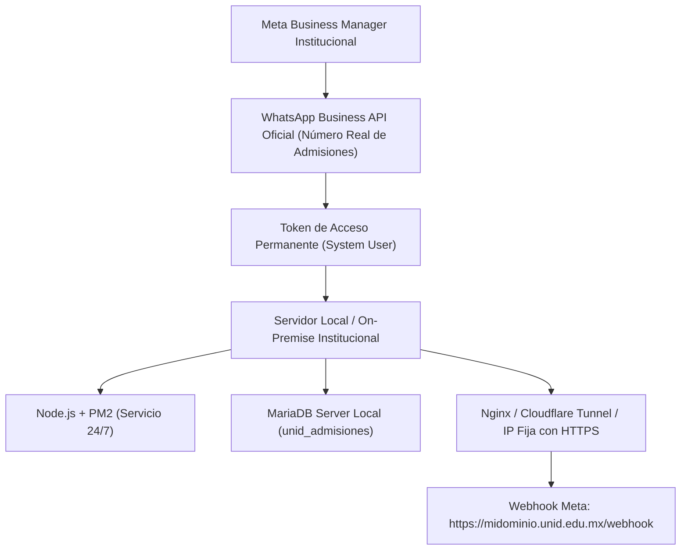
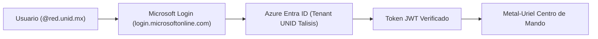

# 🐺 Metal-Uriel: Bot Inteligente de Admisiones UNID
## Documentación Técnica, Logros Alcanzados y Hoja de Ruta para Producción

---

## 📌 1. Resumen Ejecutivo del Proyecto
**Metal-Uriel** es un asistente virtual conversacional impulsado por Inteligencia Artificial generativa (**Google Gemini 3.5 Flash** / OpenAI) diseñado para la **Universidad Interamericana para el Desarrollo (UNID)**, específicamente representando al campus San Francisco de Campeche.

Su función principal es atender a los aspirantes a través de **WhatsApp Cloud API**, guiándolos mediante una conversación empática, amigable y estructurada para recopilar **11 datos clave de admisión**, aplicar reglas geográficas de oferta educativa (Presencial vs. Licenciaturas Online) y persistir automáticamente la ficha de inscripción en una base de datos **MariaDB**.

---

## 🏆 2. Lo que Hemos Logrado (Fase de Desarrollo y Validación)

### 2.1. Motor de Inteligencia Artificial
- **IA Principal:** Integración con **Google Gemini 3.5 Flash** a través del SDK oficial `@google/genai`, lo que ofrece respuestas inmediatas, alta comprensión contextual y operación continua sin costos por límites de cuota reducidos.
- **Arquitectura Multi-Proveedor:** Soporte de respaldo (*fallback*) a **OpenAI GPT-4o-mini** si se requiere.
- **Personalidad y Rol Institucional:** Personificación cibernética de "El Lobo Rojo Uriel", manteniendo un tono profesional, entusiasta y asistido por detalles sutiles (*bip-bop*).

### 2.2. Regla de Negocio Geográfica Automatizada
- **Detección de Aspirante Local vs. Foráneo:** A partir del Código Postal, Estado o Ciudad de origen del aspirante:
  - **Local (Campeche):** Oferta de carreras en modalidad **Presencial / Mixta** en Campus San Francisco de Campeche.
  - **Foráneo (Resto del país o extranjero):** Oferta activa, cálida y persuasiva de la modalidad **Licenciaturas Online (Plataforma Virtual)**, permitiendo estudiar sin necesidad de trasladarse.

### 2.3. Recopilación de los 11 Datos Obligatorios
El bot guía la conversación paso a paso para no abrumar al prospecto, capturando:
1. Nombre completo
2. Fecha de nacimiento (`AAAA-MM-DD`)
3. Sexo (Masculino / Femenino / Otro)
4. Estado de nacimiento
5. Teléfono celular
6. Correo electrónico
7. Bachillerato / Preparatoria de procedencia
8. Carrera o Licenciatura de interés
9. Dirección completa y Código Postal (CP)
10. Campus de interés
11. Modalidad de estudios (Presencial / Mixta / Licenciaturas Online)

### 2.4. Generación de Payload JSON e Inserción en MariaDB
- Al completar los 11 datos y confirmar el interés del aspirante, la IA emite un bloque JSON estructurado.
- El servidor backend valida el JSON y ejecuta la inserción relacional en la tabla `aspirantes` de **MariaDB**.
- Almacena campos normalizados + una columna `raw_json_data` con el JSON íntegro para trazabilidad y auditoría.

### 2.5. Simulador Web y Frontend de Pruebas Integrado
- Aplicación web construida con **React 18** y **Tailwind CSS**, servida directamente en el puerto `3000` (`public/`).
- **Simulador estilo WhatsApp:** Permite ingresar cualquier número de teléfono virtual para probar múltiples aspirantes en paralelo.
- **Inspector de Procesos en Tiempo Real:** Checklist visual que marca los datos recopilados, badge de aspirante local/foráneo y visor del payload generado.
- **Visor de Base de Datos:** Panel en vivo para consultar las fichas almacenadas en MariaDB sin necesidad de abrir gestores externos.

### 2.6. Integración con Meta WhatsApp Cloud API
- Endpoints implementados en Express:
  - `GET /webhook`: Validación criptográfica del handshake de Meta con `hub.verify_token` y respuesta del `challenge`.
  - `POST /webhook`: Recepción de eventos `messages`, extracción del remitente y mensaje, procesamiento con la IA y envío de respuesta vía WhatsApp Graph API.

---

## 🏛️ 3. Lo que Hace Falta para el Despliegue en la Institución (Producción)

Para llevar **Metal-Uriel** al servidor físico/local de tu universidad y conectarlo al número real de admisiones, se deben completar los siguientes puntos:



---

### 3.1. Infraestructura y Servidor Local de la Institución
1. **Servidor Físico / Máquina Virtual:**
   - Sistema Operativo recomendado: **Ubuntu Server LTS** o **Windows Server**.
   - **Node.js LTS (v20 o superior)** y **MariaDB Server** instalados localmente.
2. **Gestor de Procesos para Uptime 24/7 (PM2):**
   - En lugar de ejecutar `node index.js` manualmente en una ventana de consola, se utiliza **PM2**:
     ```bash
     npm install -g pm2
     pm2 start index.js --name "metal-uriel-bot"
     pm2 startup
     pm2 save
     ```
   - Esto garantiza que si el servidor se reinicia por corte eléctrico o mantenimiento, el bot inicie automáticamente.
3. **Dominio Público y Certificado SSL (Sustituir Ngrok):**
   - Meta requiere obligatoriamente una URL pública con protocolo seguro **HTTPS** para el Webhook.
   - *Opciones recomendadas para la institución:*
     - **Opción A (Recomendada):** Subdominio institucional (ej. `https://admisiones-bot.unid.edu.mx/webhook`) apuntando a la IP pública fija de la institución con proxy reverso **Nginx** y certificado **Let's Encrypt** (SSL).
     - **Opción B (Sin abrir puertos en el firewall):** **Cloudflare Tunnel (cloudflared)** para exponer de forma segura el puerto `3000` con SSL gestionado automáticamente.

---

### 3.2. Configuración de Meta Business Suite y WhatsApp Oficial
1. **Meta Business Account Oficial de la Universidad:**
   - La aplicación en [developers.facebook.com](https://developers.facebook.com) debe ser creada y administrada desde el **Meta Business Manager oficial** de la institución (donde se gestionan las páginas de Facebook/Instagram institucionales).
2. **Número Telefónico Oficial del Área de Admisiones:**
   - Si el número actual está registrado en una app estándar de WhatsApp o WhatsApp Business en un celular físico, debe migrarse a la API Cloud de WhatsApp (Meta Cloud API).
   - Meta enviará un código SMS/Llamada para verificar la propiedad del número.
3. **Generación del Token de Acceso Permanente (System User Token):**
   - ⚠️ *Importante:* El token de prueba que usamos en desarrollo expira a las 24 horas.
   - En producción, en el **Meta Business Manager**:
     1. Ir a **Configuración del Negocio** > **Usuarios del Sistema** (*System Users*).
     2. Crear un usuario con rol de Administrador.
     3. Asignarle el activo de la App de WhatsApp.
     4. Generar un **Token Permanente** con los permisos: `whatsapp_business_management` y `whatsapp_business_messaging`.
     5. Este token nunca caducará y se coloca en la variable `WHATSAPP_TOKEN` de producción.

---

### 3.3. Base de Datos MariaDB en Producción
1. **Ejecución del Esquema Oficial:**
   - Ejecutar el script [`schema.sql`](file:///C:/Users/luisf/OneDrive/Escritorio/metal-uriel-bot/schema.sql) en el servidor MariaDB local para crear la base de datos `unid_admisiones` y la tabla `aspirantes`.
2. **Políticas de Respaldo (Backups):**
   - Configurar una tarea programada (*Cron job* en Linux o *Task Scheduler* en Windows) para respaldar diariamente los prospectos:
     ```bash
     mysqldump -u root -p unid_admisiones > /backups/unid_admisiones_$(date +\%F).sql
     ```
3. **Seguridad y Accesos:**
   - Crear un usuario específico para la base de datos con contraseña robusta (evitar usar el usuario `root` sin restricciones).

---

### 3.4. Variables de Entorno de Producción (`.env`)
Plantilla final para el entorno productivo institucional:

```env
# Servidor
PORT=3000

# Meta WhatsApp Cloud API (Cuenta Oficial Institucional)
META_VERIFY_TOKEN=token_secreto_personalizado_unid_2026
WHATSAPP_TOKEN=EAA...token_permanente_del_system_user
WHATSAPP_PHONE_NUMBER_ID=ID_del_numero_oficial_de_admisiones

# Motor de Inteligencia Artificial (Google Gemini)
GEMINI_API_KEY=tu_api_key_de_gemini

# Base de Datos MariaDB Local
DB_HOST=127.0.0.1
DB_PORT=3306
DB_USER=unid_bot_user
DB_PASSWORD=Password_Seguro_Institucional
DB_NAME=unid_admisiones
```

---

## 🚀 4. Mejoras Implementadas e Integradas

1. **✅ Alertas Inmediatas por Correo al Equipo de Admisiones (Nodemailer):**
   - Cada vez que un aspirante completa su registro y se genera su ID de ficha, el sistema envía automáticamente una plantilla HTML institucional estilizada al correo configurado en `ADMISSIONS_NOTIFICATION_EMAIL` con todos los datos y enlaces directos para llamar o abrir WhatsApp con el alumno.
2. **✅ Exportador Oficial a Excel / CSV (`GET /api/aspirantes/export`):**
   - El personal de admisiones puede descargar toda la base de datos de prospectos en un archivo `.csv` codificado en UTF-8 con BOM (compatible al 100% con Microsoft Excel en español con acentos y caracteres especiales) con un solo clic.
3. **✅ Buscador, Filtros y Métricas en el Dashboard Web:**
   - Panel interactivo con contador de prospectos totales, locales vs. foráneos, búsqueda en tiempo real (por nombre, carrera o celular) y enlace directo a WhatsApp en el modal de detalle del prospecto.
4. **✅ Gestor Dinámico de Personalidad & Editor de Prompt (`system_prompt.txt`):**
   - El System Prompt ya no es una constante rígida. Se administra desde la pestaña **Personalidad & Prompt** en el frontend web con plantillas predefinidas (*Metal-Uriel Robótico*, *Asesor Ejecutivo Corporativo*, *Admisiones Exprés*) y un editor en vivo para ajustar la personalidad sin tocar código ni reiniciar el servidor.
5. **✅ Selector Modular de Modelos de IA (`GET /api/models`):**
   - Menú desplegable en el encabezado del frontend que permite alternar en tiempo real entre modelos de **Google Gemini** (`gemini-3.5-flash-lite`, `gemini-3.6-flash`, `gemini-3.1-pro-preview`) y **OpenAI** (`gpt-4o-mini`, `gpt-4o`), con enrutamiento dinámico en el backend y visualización del modelo exacto que generó cada respuesta.
6. **✅ Dashboard de Métricas & Rendimiento (Analytics con Chart.js):**
   - Pestaña con visualizaciones gráficas interactivas:
     - **Gráfica de Carreras:** Barras horizontales con las carreras de mayor demanda.
     - **Distribución Geográfica:** Gráfica de dona que compara prospectos locales (Campeche) vs. foráneos (candidatos a Online).
     - **Embudo de Admisiones:** Conteo de prospectos según su etapa en el ciclo de admisión.
     - **KPI de Efectividad del Bot:** Tasa de conversión y conteo de fichas completadas.
7. **✅ Tablero Kanban de Gestión de Estados:**
   - Panel tipo Trello con 5 columnas de ciclo de vida (`Nuevos Prospectos` -> `Contactados` -> `En Proceso` -> `Inscritos 🎉` -> `No Interesado`).
   - Permite al equipo de admisiones mover el estado de cada prospecto en tiempo real (`PATCH /api/aspirantes/:id/status`) y contactar inmediatamente al alumno con un botón directo a WhatsApp.
8. **✅ Monitor de Salud (Semáforo de Servicios):**
   - Widget semáforo en la barra superior que diagnostica en tiempo real la conectividad de MariaDB (con latencia en ms), motores de IA (Gemini/OpenAI), Webhook de WhatsApp y el servicio de notificaciones por email.
9. **✅ Autenticación y Seguridad Administrativa (JWT):**
   - Sistema de login seguro con JSON Web Tokens (`POST /api/auth/login`, usuario `admin` / `unid2026`) para proteger la edición de System Prompts y acciones sensibles del panel.
10. **✅ Identidad Institucional & Centro de Mando Ejecutivo UNID:**
   - Rediseño completo de UI/UX con paleta de colores oficial: **Azul Marino Profundo (`#0A192F` / `#0F172A`)**, **Amarillo/Dorado Institucional (`#FFC72C`)** e isotipos oficiales de la UNID.
11. **✅ Envío Automatizado de Documentos y Planes de Estudio (PDF):**
   - Despacho inteligente de folletos oficiales en PDF (`/api/brochures/:id/download`) cuando el aspirante solicita planes de estudio, costos o becas de cualquier carrera (Software, Derecho, Administración, Diseño, Psicología, etc.).
12. **✅ Semáforo de Interés y Priorización (Lead Scoring con IA):**
   - Calificación automática de entusiasmo y probabilidad de cierre (`Alto` 🔥 / `Medio` ⚡ / `Bajo` ❄️) almacenada en MariaDB y visible en el Kanban para priorizar llamadas de admisión.
13. **✅ Resumen Ejecutivo de Interacción en un Vistazo (`resumen_ia`):**
   - Síntesis de 2 líneas generada por la IA para que el equipo humano entienda el perfil, necesidades y modalidad ideal del alumno en menos de 3 segundos sin leer todo el chat.
14. **✅ Seeder de Datos de Demostración de Alta Fidelidad (`POST /api/aspirantes/seed`):**
   - Carga instantánea de prospectos limpios y realistas para presentaciones ante Directores y el departamento de TI.
15. **✅ Patrón de Fallback (Respaldo) en Cascada Multi-Proveedor & Circuit Breaker:**
   - **Alta Disponibilidad 24/7:** Inferencia protegida contra caídas de proveedores o agotamiento de cuotas (HTTP 429/403/503).
   - **Adaptadores Normalizados:** Integración uniforme para **Google Gemini** (`gemini-3.5-flash-lite`, `gemini-3.6-flash`, `gemini-3.1-pro`), **Anthropic Claude** (`claude-3-5-haiku`, `claude-3-5-sonnet`), **OpenAI** (`gpt-4o-mini`, `gpt-4o`), **DeepSeek** (`deepseek-chat`) y **Groq** (`llama-3.3-70b`).
   - **Circuit Breaker con Tiempo de Enfriamiento (Cooldown):** Si un proveedor agota tokens o límites de tasa, el sistema lo pone automáticamente en enfriamiento de 10 minutos y salta al siguiente proveedor sin pausas ni latencia perceptible para el aspirante.
   - **Filtrado Inteligente de Modelos:** El selector del panel oculta de inmediato cualquier modelo cuya API Key no esté configurada en `.env`.
16. **✅ Preservación de Contexto sin Amnesia (*Zero-Brain-Damage Context Preservation*):**
   - Si un modelo de IA agota su cuota de tokens o falla a mitad de una conversación con un aspirante, el sistema de fallback transfiere de forma transparente **el 100% del historial de mensajes previo** al siguiente modelo en cascada.
   - **Inyección de Salvaguarda de Continuidad:** El servidor inyecta un protocolo que instruye al modelo de reemplazo a analizar el historial y **NUNCA volver a preguntar datos ya respondidos**, evitando que el bot "olvide" lo que el alumno ya le había contado.
    - Si un modelo de IA agota su cuota de tokens o falla a mitad de una conversación con un aspirante, el sistema de fallback transfiere de forma transparente **el 100% del historial de mensajes previo** al siguiente modelo en cascada.
    - **Inyección de Salvaguarda de Continuidad:** El servidor inyecta un protocolo que instruye al modelo de reemplazo a analizar el historial y **NUNCA volver a preguntar datos ya respondidos**, evitando que el bot "olvide" lo que el alumno ya le había contado.
17. **✅ Autenticación Institucional con Office 365 / Microsoft Entra ID (`@red.unid.mx`):**
    - El personal de admisiones y TI puede iniciar sesión utilizando su cuenta de correo institucional (`00774343@red.unid.mx` o `@unid.mx`).
    - El sistema valida el dominio educativo, emite un JWT firmado y muestra una insignia institucional verificada con Single Sign-On (SSO).
18. **✅ Reproductor Cyber HUD & Banda Sonora de Metal Sonic (YouTube OST @ 1515s):**
    - Widget interactivo con estética cibernética en la barra superior del Centro de Mando.
    - Conectado a la banda sonora oficial de Metal Sonic (`https://www.youtube.com/watch?v=nR9BxVgma_8&t=1515s` a partir del minuto 25:15).
    - Incluye animación de ecualizador de audio (*sound visualizer*), controles de reproducción/pausa y silencio, y activación automática al iniciar sesión.
19. **✅ Gestor Dinámico de Planes de Estudio y Folletos (`GET/POST/PUT/DELETE /api/brochures`):**
    - El personal de admisiones puede dar de alta, actualizar URLs de PDF, modificar claves RVOE SEP, cambiar duraciones o eliminar planes de estudio directamente desde la pestaña **Planes de Estudio** en el frontend.
    - Los cambios se persisten de inmediato en `brochures.json` y la IA los utiliza automáticamente para el envío de folletos por WhatsApp y en el simulador.
20. **✅ Clasificación Oficial de Oferta Académica (Campus Campeche vs. UNID Online Nacional):**
    - Distinción clara e interactiva entre:
      - **🏛️ Campus San Francisco de Campeche (Presencial):** 10 Licenciaturas escolarizadas (Ing. Software y Sistemas, Derecho, Administración de Empresas, Admón. de Empresas Turísticas, Arquitectura de Interiores, Ciencias y Técnicas de la Comunicación, Contabilidad y Finanzas, Diseño Gráfico y Digital, Educación Física y Deporte, Mercadotecnia y Publicidad).
      - **👔 Campus Campeche (Modalidad Ejecutiva & Dual):** 4 Licenciaturas Ejecutivas para personas que trabajan + Licenciatura Dual en Administración.
      - **🌐 UNID Nacional (Modalidad 100% Online):** Licenciaturas virtuales de cobertura nacional (Psicología Organizacional, Criminología y Criminalística, Pedagogía, Comercio y Negocios Internacionales).
    - Cada carrera cuenta con su enlace directo al PDF oficial en la CDN de Talisis (`https://digitalmedia.talisis.com/unid/plan-de-estudios/2024/...`) o generación de plantilla institucional en caso de no contar con archivo externo.

---

## 🏢 5. Guía de Configuración de Microsoft Office 365 (Azure Entra ID) para TI UNID

Para integrar el inicio de sesión institucional con la infraestructura de Microsoft 365 de la UNID:



1. **Registro de la Aplicación en Azure Portal:**
   - Ingresar a [portal.azure.com](https://portal.azure.com) con credenciales de Administrador Global o de Aplicaciones.
   - Ir a **Microsoft Entra ID** > **App registrations** > **New registration**.
   - **Nombre:** `Metal-Uriel Centro de Mando Admisiones UNID`.
   - **Tipos de cuenta admitidos:** *Solo cuentas de este directorio organizativo (Inquilino único - UNID Talisis)*.
   - **URI de redirección (Web):** `https://admisiones-bot.unid.edu.mx/api/auth/microsoft/callback` (o `http://localhost:3000`).

2. **Permisos de API (Microsoft Graph):**
   - En **API permissions**, agregar:
     - `User.Read` (Permiso delegado para leer el perfil básico y correo del usuario que inicia sesión).
   - Conceder el consentimiento del administrador para el tenant de la institución.

3. **Restricción de Dominio Educativo:**
   - El backend de Metal-Uriel valida estrictamente que la terminación del correo sea `@red.unid.mx`, `@unid.mx` o `@talisis.com`, bloqueando cualquier intento de acceso con correos externos personales (Gmail, Hotmail, etc.).

