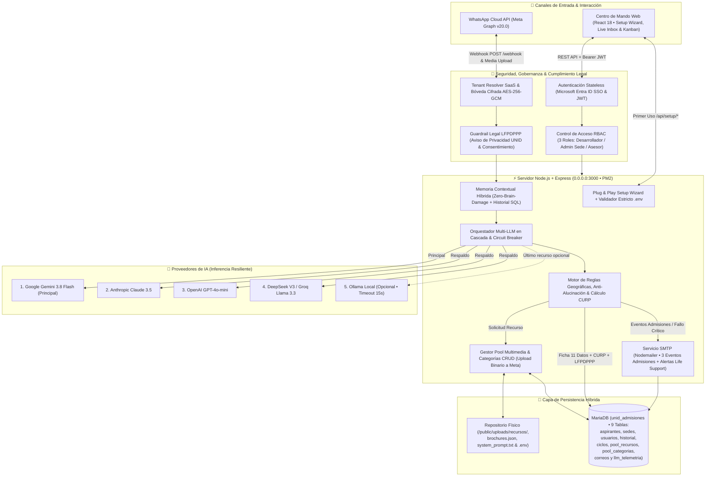

# 🐺 Metal-Uriel v2.0 • Centro de Mando & Asistente Inteligente de Admisiones UNID (Plug & Play)

<div align="center">


**Plataforma conversacional SaaS Multi-Tenant de admisiones universitarias impulsada por IA generativa multi-proveedor (`Google Gemini 3.8 Flash` + cascada cloud + `Ollama` local opcional), Asistente de Instalación Plug & Play en el navegador, tablero Kanban, Pool Multimedia CRUD con envío binario real a WhatsApp, cumplimiento LFPDPPP, RBAC de 3 roles y monitoreo de alertas críticas ("Life Support").**

[Instalación Plug & Play](#-guía-de-instalación-plug--play-desde-cero) • [Software de Terceros](#-1-instalación-de-software-de-terceros) • [Asistente Web y Reglas de API Keys](#-3-asistente-de-primera-configuración-setup-wizard) • [Servidor 24/7 (PM2 + LAN + HTTPS)](#-4-puesta-en-producción-247-en-la-pc-dedicada) • [Ollama Local (Opcional)](#-5-ollama-local-en-cascada-opcional-y-recomendaciones-de-hardware) • [Soporte Remoto y Life Support](#-6-soporte-remoto-y-alertas-críticas-life-support) • [Arquitectura](#-arquitectura-del-sistema)

</div>

---

## ⚡ ¿Qué trae la Build Plug & Play v2.0?

Diseñada específicamente para **clonar desde GitHub en un equipo recién formateado y ponerla a operar en caliente**:

1. **Asistente de Primera Configuración en el Navegador (`Setup Wizard`):**
   - Al arrancar sin `.env` o con un `.env` virgen (`SETUP_COMPLETED=false`), el servidor inicia limpio en el puerto `3000` y abre un asistente guiado de 5 pasos en `http://localhost:3000`.
   - **Validación estricta en vivo por tipo y longitud de credencial** (ej. `WHATSAPP_PHONE_NUMBER_ID` solo 10–20 dígitos, `WHATSAPP_TOKEN` prefijo `EAA...`, `GEMINI_API_KEY` prefijo `AIza...`, contraseñas fuertes con generador criptográfico CSPRNG de 20 caracteres).
   - **Botones de prueba real en cada paso:** verifica conexión a MariaDB, ping en vivo a Gemini 3.8 Flash / OpenAI / Groq / Ollama, consulta real a Meta Graph API y envío de correo SMTP de prueba **antes** de guardar.
2. **Auto-Creación de MariaDB (Zero SQL Manual):**
   - Ya no necesitas importar `schema.sql` a mano: el servidor crea automáticamente la base `unid_admisiones` y sus **8 tablas**, siembra las 23 sedes UNID, las 5 categorías del Pool Multimedia, el ciclo escolar activo y los PDFs oficiales.
3. **Blindaje Automático de Producción:**
   - Genera llaves únicas de 256 bits para `JWT_SECRET` y `ENCRYPTION_MASTER_KEY` (AES-256-GCM).
   - Crea tus cuentas institucionales RBAC con hash `scrypt + salt` aleatorio, **desactiva cuentas demo por defecto** y bloquea `/api/setup/*` salvo para sesiones autenticadas con rol `desarrollador`.
4. **Ollama Local Opcional (Último Recurso):**
   - Integrado al final de la cascada (`Gemini → Claude → OpenAI → DeepSeek → Groq → Ollama Local`) con **timeout estricto** (`15000 ms`) y **auditoría automática de RAM/CPU** dentro del asistente.
5. **Alertas Críticas "Life Support" por Correo (Nodemailer):**
   - Avisa automáticamente a `ALERT_ADMIN_EMAIL` (con anti-spam de 15 min) si todos los proveedores de IA fallan o ocurre una excepción crítica, además de los 3 avisos de Admisiones (*Nuevo Contacto*, *Ficha de 11 Datos* e *Inscrito*).

---

## 🚀 Guía de Instalación Plug & Play (Desde Cero)

> 💡 **Recomendación de Sistema Operativo para una PC dedicada con ~8 GB RAM:**
> - **Opción A (Recomendada por eficiencia): Ubuntu Server 24.04 LTS** (consume ~450 MB de RAM en reposo, dejando ~7.5 GB libres para MariaDB, Node.js y opcionalmente Ollama).
> - **Opción B (Más familiar): Windows 10 / 11 Pro (64-bit)** (consume ~2.5–3.5 GB de RAM; perfecto para Metal-Uriel + MariaDB + RustDesk + Cloudflare Tunnel; en este caso dejar Ollama apagado salvo comprobar ≥ 4 GB RAM libres).

---

### 📦 1. Instalación de Software de Terceros

#### Opción A — Windows 10 / 11 (Comandos `winget` en PowerShell como Administrador)

Abre **PowerShell como Administrador** y ejecuta:

```powershell
# 1. Git (para clonar y actualizar desde GitHub)
winget install --id Git.Git -e --source winget

# 2. Node.js v22 LTS (runtime del servidor Metal-Uriel)
winget install --id OpenJS.NodeJS.LTS -e --source winget

# 3. MariaDB 11.x (motor de base de datos relacional)
winget install --id MariaDB.Server -e --source winget

# 4. Cloudflare Tunnel (HTTPS público gratis para Webhook de Meta sin abrir puertos)
winget install --id Cloudflare.cloudflared -e --source winget

# 5. RustDesk (acceso remoto desatendido desde tu casa)
winget install --id RustDesk.RustDesk -e --source winget
```

> **Durante el instalador de MariaDB en Windows:**
> - Asigna una **contraseña fuerte al usuario `root`** y guárdala (la usarás en el Paso 1 del Asistente Web).
> - Deja marcada la casilla **"Install as service"** (`MariaDB`, puerto `3306`) y **UTF-8** como charset predeterminado.
> - *Cierra y vuelve a abrir PowerShell* tras instalar para que `git`, `node` y `npm` queden en el `PATH`.

Verifica instalación:
```powershell
git --version
node -v
npm -v
```

---

#### Opción B — Ubuntu Server / Linux (24.04 LTS)

```bash
# Actualizar sistema e instalar herramientas base
sudo apt update && sudo apt upgrade -y
sudo apt install -y git curl build-essential mariadb-server ufw

# Instalar Node.js v22 LTS (NodeSource)
curl -fsSL https://deb.nodesource.com/setup_22.x | sudo -E bash -
sudo apt install -y nodejs

# Habilitar MariaDB al arranque y crear usuario dedicado (RECOMENDADO)
sudo systemctl enable --now mariadb
sudo mysql -e "CREATE USER IF NOT EXISTS 'metal_uriel'@'localhost' IDENTIFIED BY 'CAMBIA_ESTA_CLAVE_FUERTE_2026!';"
sudo mysql -e "GRANT ALL PRIVILEGES ON *.* TO 'metal_uriel'@'localhost' WITH GRANT OPTION; FLUSH PRIVILEGES;"

# Instalar PM2 global (gestor de procesos 24/7)
sudo npm install -g pm2

# Instalar Cloudflare Tunnel (cloudflared)
curl -L https://github.com/cloudflare/cloudflared/releases/latest/download/cloudflared-linux-amd64.deb -o cloudflared.deb
sudo dpkg -i cloudflared.deb && rm cloudflared.deb
```

---

### ⬇️ 2. Clonar y Arrancar en Caliente

```bash
git clone https://github.com/Luso233/Metal-Uriel.git
cd Metal-Uriel
```

- **En Windows (1 doble clic):** ejecuta **`iniciar-metal-uriel.bat`**
  *(Automáticamente instala `node_modules`, copia `.env.example` → `.env` virgen, levanta Metal-Uriel y abre `http://localhost:3000`).*
- **En Linux / terminal manual:**
  ```bash
  chmod +x iniciar-metal-uriel.sh
  ./iniciar-metal-uriel.sh
  ```
  *(O manualmente: `npm install --omit=dev && cp .env.example .env && npm start`)*

Al arrancar, la consola imprimirá automáticamente la **IP de Red Local (LAN)** del servidor para que todo el Departamento de Admisiones pueda conectarse:
```text
🐺 :UNID Centro de Mando • Metal-Uriel v2.0 (Plug & Play)
💻 Hardware: 4 núcleos | RAM: 4.82/8.00 GB libre
🌐 Acceso Local: http://localhost:3000
🏢 Acceso Red Local (LAN Admisiones): http://192.168.1.50:3000
🧩 PRIMER USO DETECTADO: Abre http://localhost:3000 en tu navegador para completar el Asistente de Instalación.
```

---

### 🧩 3. Asistente de Primera Configuración (Setup Wizard) y Reglas de Validación

Al abrir `http://localhost:3000` por primera vez aparecerá el **Asistente Plug & Play de 5 pasos**. Cada credencial es validada tanto en el navegador como en el servidor con reglas estrictas de longitud y formato:

| Variable | Regla de Formato Validada | Longitud | Notas |
| :--- | :--- | :--- | :--- |
| `DB_HOST` / `DB_PORT` | Hostname/IP válida + puerto solo dígitos (`3306`) | 1–253 / 2–5 | Botón **"Probar Conexión con MariaDB"** en vivo |
| `GEMINI_API_KEY` | Prefijo **`AIza`**, alfanumérico/`_`/`-`, sin espacios | **35–55 chars** (estándar 39) | Motor principal **`gemini-3.8-flash`** (Google AI Studio) |
| `OPENAI_API_KEY` | Prefijo **`sk-`** o **`sk-proj-`**, sin espacios | **32–220 chars** | Respaldo automático en cascada |
| `ANTHROPIC_API_KEY` | Prefijo **`sk-ant-`**, sin espacios | **40–180 chars** | Respaldo automático en cascada |
| `GROQ_API_KEY` | Prefijo **`gsk_`**, sin espacios | **40–120 chars** | Tier gratuito ultra rápido en LPU |
| `DEEPSEEK_API_KEY` | Prefijo **`sk-`**, sin espacios | **24–120 chars** | Respaldo económico |
| `WHATSAPP_PHONE_NUMBER_ID` | **EXACTAMENTE solo números** (`/^\d{10,20}$/`) | **10–20 dígitos** | ID de Meta Developers (NO tu número `+52...`) |
| `WHATSAPP_TOKEN` | Prefijo **`EAA`**, solo letras/números/`_`/`-` | **80–500 chars** | Token Permanente de *System User* en Meta Business |
| `META_VERIFY_TOKEN` | Letras, números, `_` y `-` (sin espacios) | **8–128 chars** | Incluye botón generador automático |
| `JWT_SECRET` / `ENCRYPTION_MASTER_KEY` | Secreto aleatorio sin espacios | **32–128 chars** | Botón **"Generar Llaves 256-bit"** incluido |
| `DEV_PASSWORD` / `ADMIN_SEDE_PASSWORD` | ≥1 mayúscula, ≥1 minúscula, ≥1 dígito, ≥1 símbolo | **12–128 chars** | Botón **"Generar 20 chars"** + copiar; cifrado `scrypt` |
| `SMTP_PORT` / `SMTP_PASS` | Puerto `587`/`465`/`2525`/`25` + App Password | **8–128 chars** | Botón **"Probar SMTP"** envía correo real |

> 🔐 **Seguridad post-instalación:** Una vez guardado el `.env`, el Asistente queda bloqueado para el público. Solo tú (iniciando sesión como **Desarrollador**) podrás volver a abrirlo desde el botón **`⚙️ Setup / .env`** en la barra superior. Además, en **Gestión de Usuarios** tienes el botón **`🎲 Generar Segura (20 chars)`** para crear las cuentas institucionales (`@red.unid.mx`) del equipo de admisiones con contraseñas fuertes cifradas con `scrypt`.

---

### 🏢 4. Puesta en Producción 24/7 en la PC Dedicada

#### 4.1 Desactivar suspensión y fijar red local (Windows)
Ejecuta en **PowerShell como Administrador**:
```powershell
# Evitar que la PC se suspenda o hiberne nunca
powercfg /change standby-timeout-ac 0
powercfg /change hibernate-timeout-ac 0
powercfg /hibernate off

# Permitir acceso del Departamento de Admisiones al puerto 3000 SOLO en la red privada LAN
New-NetFirewallRule -DisplayName "Metal-Uriel UNID LAN (3000)" -Direction Inbound -Protocol TCP -LocalPort 3000 -Profile Private -Action Allow
```
> En **Linux (`ufw`)**: `sudo ufw allow from 192.168.0.0/16 to any port 3000 proto tcp && sudo ufw enable`
> *(Pide a Sistemas que reserve una **IP estática / reserva DHCP** para la MAC de esta PC, por ejemplo `192.168.1.50`, para que los asesores siempre entren a `http://192.168.1.50:3000`).*

#### 4.2 Dejar Metal-Uriel corriendo 24/7 con auto-reinicio (PM2)
```bash
# Instalar PM2 global
npm install -g pm2

# Arrancar usando la configuración optimizada (límite 450 MB RAM, auto-restart)
npm run prod
pm2 save
```
- **Para que reviva solo si se va la luz en Windows:**
  ```powershell
  npm install -g pm2-windows-startup
  pm2-startup install
  pm2 save
  ```
- **Para que reviva solo en Linux (systemd):**
  ```bash
  pm2 startup systemd
  # Ejecuta el comando que PM2 imprime en pantalla y luego:
  pm2 save
  ```
Comandos diarios útiles: `npm run prod:logs`, `npm run prod:restart`, `pm2 monit`.

#### 4.3 Exponer Webhook HTTPS seguro para Meta sin abrir puertos (Cloudflare Tunnel)
Meta exige una URL **HTTPS pública** para `https://tu-dominio/webhook`. Con **Cloudflare Tunnel (`cloudflared`)** NO necesitas abrir puertos en el router de la UNID:

- **Prueba rápida inmediata (túnel temporal sin dominio propio):**
  ```bash
  cloudflared tunnel --url http://localhost:3000
  ```
  Copia la URL `https://xxxx.trycloudflare.com/webhook` en **Meta Developers → WhatsApp → Configuración → Webhook** junto con tu `META_VERIFY_TOKEN`.
- **Producción fija permanente (recomendado):** Crea un túnel nombrado gratuito en [Cloudflare Zero Trust Dashboard](https://one.dash.cloudflare.com/) → *Networks → Tunnels* apuntando `admisiones-bot.tudominio.com` → `http://localhost:3000`, e instálalo como servicio de Windows/Linux con el comando `cloudflared service install <TOKEN>` que te da Cloudflare.

---

### 🦙 5. Ollama Local en Cascada (Opcional y Recomendaciones de Hardware)

Metal-Uriel incluye soporte nativo para **Ollama** estrictamente como **último eslabón opcional** (`OLLAMA_ENABLED=false` por defecto):

```text
Google Gemini 3.8 Flash → Claude / OpenAI / DeepSeek / Groq → [Ollama Local (solo si está activo, timeout 15s)]
```

| RAM Total del Equipo | Recomendación | Modelo Sugerido |
| :--- | :--- | :--- |
| **< 8 GB RAM** | ❌ **NO activar Ollama.** Usa Gemini 3.8 Flash + Groq/OpenAI de respaldo. | Ninguno |
| **8 GB RAM (CPU)** | ⚠️ **Solo pruebas / último recurso** (preferiblemente en Linux). Medir RAM libre primero. | `qwen2.5:3b` (~2.0 GB) o `llama3.2:3b` (~2.0 GB) |
| **16+ GB RAM o GPU** | ✅ **Viable como respaldo local sólido.** | `qwen2.5:3b` o `llama3.1:8b` |

Si decides probarlo tras verificar memoria libre:
```bash
# 1. Instalar Ollama: https://ollama.com/download (Windows) o curl -fsSL https://ollama.com/install.sh | sh (Linux)
# 2. Descargar modelo ligero en español:
ollama pull qwen2.5:3b

# 3. Activar en el botón "⚙️ Setup / .env" → Paso 2 → Marcar Ollama Local y pulsar "Detectar Ollama"
```

---

### 🛡️ 6. Soporte Remoto y Alertas Críticas ("Life Support")

1. **Alertas por Correo Integradas (Sin software extra):**
   - Configura `ALERT_ADMIN_EMAIL` + `SMTP_*` en el Paso 5 del Asistente. Si en cualquier momento fallan todos los LLMs o ocurre una excepción no controlada, recibirás un correo de alerta con el error, uso de RAM e IP del servidor.
   - Puedes probarlo en cualquier momento desde `POST /api/system/test-alert` (rol Desarrollador).
2. **Mantenimiento Remoto Seguro (Desde tu casa):**
   - **RustDesk:** Instala RustDesk en la PC del campus, configura una **contraseña permanente larga** en *Seguridad → Acceso desatendido*, y desactiva la pantalla de bloqueo que corte la red.
   - **Tailscale (Altamente recomendado — ~25 MB RAM):** Instala [Tailscale](https://tailscale.com/download) en la PC del campus y en tu laptop personal para tener VPN privada cifrada (WireGuard) hacia el panel y SSH sin exponer nada a internet.
   - **Nota sobre agentes autónomos locales (ej. OpenClaw):** Por cumplimiento **LFPDPPP** (la base de datos almacena datos personales y CURP de aspirantes) y presupuesto de RAM en un equipo de 8 GB, **no se recomienda instalar agentes con acceso a shell en el mismo servidor productivo de Admisiones**. Mantén la administración remota restringida a **RustDesk / Tailscale + alertas SMTP + PM2**.
3. **Respaldos Diarios de MariaDB (`mysqldump`):**
   - **Windows (Programador de Tareas diario 02:00 AM):**
     ```cmd
     "C:\Program Files\MariaDB 11.x\bin\mysqldump.exe" -u root -pTU_PASS unid_admisiones > C:\Backups\unid_admisiones_%date:~-4,4%-%date:~-7,2%-%date:~-10,2%.sql
     ```
   - **Linux (`crontab -e`):**
     ```cron
     0 2 * * * mysqldump -u metal_uriel -p'TU_PASS' unid_admisiones | gzip > /var/backups/unid_admisiones_$(date +\%F).sql.gz
     ```

---

## 🏛️ Arquitectura del Sistema



---

## 🛡️ Blindaje de Producción, Docker y Pruebas Automatizadas (v2.1)

- **Seguridad P0 Activada por Defecto:**
  - **100% de rutas administrativas protegidas con JWT + RBAC** (`desarrollador`, `administrador`, `usuario`) y aislamiento automático por `sede_id`.
  - **Verificación criptográfica HMAC-SHA256 (`X-Hub-Signature-256`)** en `POST /webhook` al configurar `META_APP_SECRET` (32 caracteres hexadecimales de Meta Developers → Configuración → Básica).
  - **Helmet + Rate Limiting** (`express-rate-limit`) en autenticación (`/api/auth/*`), simulador (`/api/chat`) y webhook (`/webhook`), con `trust proxy` listo para Cloudflare Tunnel.
  - **Recolector TTL 24/7 en RAM:** Purga automática cada 30 minutos de sesiones inactivas > 24 horas (preservando chats en control humano) para estabilidad 24/7 en PCs de 8 GB RAM.
  - **Telemetría LLM (`llm_telemetria`):** Registra latencia, proveedor, modelo, fallbacks y costo estimado en MXN (compatible con Langfuse opcional vía `LANGFUSE_*`).
- **Despliegue Alternativo con Docker Compose (Opcional):**
  ```bash
  docker compose up -d --build
  ```
  Levanta **Node.js 20 Alpine + MariaDB 11.4** con volúmenes persistentes y healthcheck en `/api/health`.
- **Suite de Pruebas Automatizadas y CI:**
  ```bash
  npm run check   # Sintaxis JS
  npm test        # 18 pruebas: RBAC, HMAC, CURP RENAPO, Guardrails, RAM GC y Setup Wizard
  ```
  Ejecutado automáticamente en cada push/PR mediante `.github/workflows/ci.yml` junto con escaneo anti-fuga de secretos.

---

## 📡 Referencia Rápida de Endpoints Principales

- **Instalación Plug & Play:** `GET /api/setup/status`, `POST /api/setup/validate`, `POST /api/setup/test-db`, `POST /api/setup/test-ai`, `POST /api/setup/test-whatsapp`, `POST /api/setup/test-smtp`, `POST /api/setup/complete`, `POST /api/system/test-alert`.
- **Conversación & Webhook:** `GET/POST /webhook` (HMAC `X-Hub-Signature-256`), `POST /api/chat`, `POST /api/conversations/send-message`, `POST /api/conversations/toggle-ai`, `POST /api/conversations/send-brochure`.
- **Prospectos, Kanban & Analítica:** `GET /api/aspirantes`, `PATCH /api/aspirantes/:id/status`, `PATCH /api/aspirantes/:id/archive`, `DELETE /api/aspirantes/:id`, `GET /api/aspirantes/export`, `GET /api/analytics` (+ telemetría LLM), `GET /api/health/full`.
- **Pool Multimedia & Categorías CRUD:** `GET/POST/PUT/DELETE /api/pool/categories`, `GET/POST/PUT/DELETE /api/pool`, `GET /api/brochures/:id/download`.
- **RBAC, Sedes & IA:** `POST /api/auth/login`, `POST /api/auth/o365`, `GET/POST/PUT/DELETE /api/users`, `GET/PUT/POST /api/tenants/:slug`, `POST /api/tenants/:slug/test-connection`, `GET /api/models`, `POST /api/models/active`, `GET/POST /api/prompt`.

---

## 📄 Licencia

Licencia **ISC**. Desarrollado por **Luis Felipe Quintero Cervera** para la **Universidad Interamericana para el Desarrollo (UNID) — Campus San Francisco de Campeche**.
