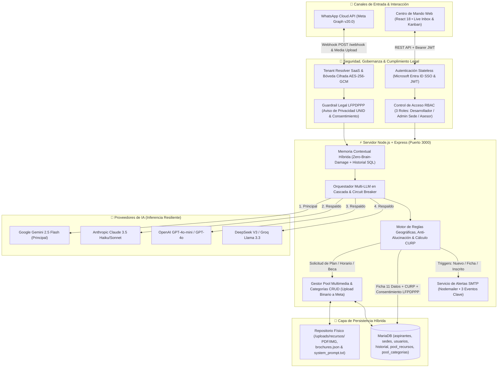

# 🐺 Metal-Uriel • Centro de Mando & Asistente Inteligente de Admisiones UNID

<div align="center">


**Plataforma conversacional de admisiones universitarias impulsada por Inteligencia Artificial generativa multi-proveedor, gestión de prospectos tipo Kanban, despacho automático de planes de estudio en PDF y analíticas en tiempo real para todas las sedes de la UNID.**

[Características](#-características-principales) • [Arquitectura](#-arquitectura-del-sistema) • [Inicio Rápido](#-instalación-y-puesta-en-marcha) • [Variables de Entorno](#-variables-de-entorno-env) • [Endpoints de la API](#-referencia-de-la-api) • [Producción](#-despliegue-en-producción)

</div>

---

## 📌 Visión General

**Metal-Uriel** es una solución integral de software diseñada para transformar la experiencia de captación, atención y seguimiento de prospectos en la **Universidad Interamericana para el Desarrollo (UNID)**. 

Personificado como el embajador cibernético del lobo rojo institucional (*Metal-Uriel 🐺🤖*), el sistema opera a través de **WhatsApp Cloud API** y una aplicación web interactiva (**Centro de Mando**), guiando de forma empática y ágil a los aspirantes a lo largo del proceso de admisión, recopilando **11 campos obligatorios**, aplicando **reglas geográficas inteligentes** (Presencial vs. Licenciaturas Online) y persistiendo cada expediente en una base de datos relacional **MariaDB**.

---

## ✨ Características Principales

### 🧠 1. Motor de Inferencia en Cascada Multi-Proveedor & Circuit Breaker
- **Alta Disponibilidad 24/7:** Inferencia tolerante a fallos con soporte unificado para:
  - **Google Gemini** (`gemini-2.5-flash`, `gemini-2.5-flash-lite`, `gemini-2.5-pro`)
  - **Anthropic Claude** (`claude-3-5-haiku`, `claude-3-5-sonnet`)
  - **OpenAI** (`gpt-4o-mini`, `gpt-4o`)
  - **DeepSeek** (`deepseek-chat`)
  - **Groq Cloud** (`llama-3.3-70b-versatile`)
- **Circuit Breaker con Cooldown:** Si un proveedor alcanza límites de tasa (HTTP 429) o agota su cuota, el sistema lo pone en enfriamiento de 10 minutos y conmuta inmediatamente al siguiente motor.
- **Zero-Brain-Damage Context Preservation:** Si ocurre un cambio de modelo a mitad de una plática, el 100% del historial se transfiere intacto con salvaguardas para no repetir preguntas ya respondidas.

### 🌐 2. Escalabilidad Multi-Campus Nacional
- **Selector de Sede Integrado:** Adaptable para el campus San Francisco de Campeche, Cancún, Mérida, Tijuana, Guadalajara, Toluca o cobertura nacional 100% virtual (**UNID Online**).
- **Filtrado Dinámico:** El personal de admisiones puede alternar entre sedes y consultar prospectos y métricas específicas por campus o a nivel global.

### 📋 3. Tablero Kanban con Gestión de Ciclo de Vida
- Flujo de seguimiento visual de 5 etapas: `Nuevos Prospectos` ➔ `Contactados` ➔ `En Proceso / Cita` ➔ `Inscritos 🎉` ➔ `No Interesado`.
- **Archivar / Desarchivar:** Permite archivar alumnos inscritos o concluidos para mantener el tablero operativo despejado, con switch para consultar el historial archivado.
- **Timestamps de Última Interacción:** Indicador relativo de última actividad (*«Hace 5 min»*, *«Ayer 14:30»*) para priorizar respuestas inmediatas.
- **Lead Scoring & Resumen IA:** Calificación de probabilidad de inscripción (`Alto 🔥`, `Medio ⚡`, `Bajo ❄️`) y síntesis ejecutiva de 2 líneas para atender llamadas en segundos.

### 📄 4. Despacho Automatizado de Planes de Estudio (PDF)
- Detección contextual de solicitudes de planes de estudio, costos o becas.
- Envío directo de folletos y mapas curriculares oficiales alojados en la CDN de Talisis (`digitalmedia.talisis.com`) o generación de plantilla membretada con validez oficial ante la **SEP (RVOE)**.

### 🛡️ 5. Catálogo Oficial & Regla Estricta Anti-Alucinaciones
- El bot cuenta con la lista exhaustiva de carreras autorizadas (Presenciales, Ejecutivas, Plan Dual y Online Nacional).
- Si un aspirante solicita una carrera no disponible (ej. *Medicina*, *Gastronomía*, *Veterinaria*), la IA aclara con cortesía la oferta oficial y sugiere programas afines.

### 🧪 6. Laboratorio de Pruebas Flotante (`Test Suite`)
- Menú modal flotante accesible desde cualquier pantalla con decenas de casos de prueba estructurados en 6 categorías (Presenciales, Foráneos, Ejecutivas, PDFs, Casos Borde y Anti-Alucinaciones) ejecutables con un solo clic.

### 🔐 7. Acceso Seguro con Microsoft Office 365 (Azure Entra ID)
- Inicio de sesión con cuentas institucionales `@red.unid.mx` / `@unid.mx` con validación de dominio educativo, o acceso administrativo local con tokens firmados **JWT**.

### 🎧 8. Cyber HUD & Banda Sonora de Metal Sonic
- Widget interactivo en la barra superior conectado a la banda sonora oficial cibernética de Metal Sonic en YouTube (a partir del minuto 25:15) con ecualizador animado.

---

## 🏛️ Arquitectura del Sistema



---

## 🛠️ Stack Tecnológico

| Capa | Tecnologías |
| :--- | :--- |
| **Backend** | Node.js (v20+), Express.js, MySQL2 (Pool de conexiones con auto-reconexión) |
| **Inteligencia Artificial** | `@google/genai`, `@anthropic-ai/sdk`, `openai`, SDKs oficiales compatibles con DeepSeek y Groq |
| **Frontend** | React 18 (Standalone), Tailwind CSS 3.4, Chart.js, Lucide Icons |
| **Base de Datos** | MariaDB 11.x / MySQL 8.x con índices optimizados y almacenamiento de JSON |
| **Mensajería & Notificaciones** | Meta WhatsApp Cloud API (Graph API v21.0), Nodemailer (SMTP) |
| **Seguridad** | JSON Web Tokens (`jsonwebtoken`), Azure Entra ID / Microsoft 365 SSO |

---

## 🚀 Instalación y Puesta en Marcha

### Prerrequisitos
1. **Node.js (v20 o superior)** y **npm** instalados.
2. **MariaDB Server** o **MySQL Server** en ejecución.
3. Al menos una API Key de Inteligencia Artificial (**Google Gemini**, **OpenAI**, **Claude**, etc.).

### Paso 1: Clonar el repositorio
```bash
git clone https://github.com/tu-usuario/metal-uriel-bot.git
cd metal-uriel-bot
```

### Paso 2: Instalar dependencias
```bash
npm install
```

### Paso 3: Configurar variables de entorno
Copia la plantilla de ejemplo y configura tus claves:
```bash
cp .env.example .env
```
Edita `.env` con tus credenciales (consulta la sección [Variables de Entorno](#-variables-de-entorno-env)).

### Paso 4: Inicializar la base de datos MariaDB
Ejecuta el script SQL en tu cliente MariaDB:
```bash
mysql -u root -p < schema.sql
```
*(Nota: El servidor cuenta con migraciones automáticas que crearán o actualizarán las tablas al arrancar si la base de datos `unid_admisiones` existe).*

### Paso 5: Iniciar el servidor
```bash
# Modo producción
npm start

# Modo desarrollo con recarga en vivo
npm run dev
```

Abre tu navegador en:
👉 **`http://localhost:3000`**

---

## 🔑 Variables de Entorno (`.env`)

```env
# ==========================================
# Servidor
# ==========================================
PORT=3000

# ==========================================
# Meta WhatsApp Cloud API
# ==========================================
META_VERIFY_TOKEN=token_secreto_personalizado_unid_2026
WHATSAPP_TOKEN=EAA...token_de_meta_cloud_api
WHATSAPP_PHONE_NUMBER_ID=ID_del_telefono_de_admisiones

# ==========================================
# Proveedores de Inteligencia Artificial
# ==========================================
GEMINI_API_KEY=AIzaSy...tu_clave_gemini
ANTHROPIC_API_KEY=sk-ant-...tu_clave_claude
OPENAI_API_KEY=sk-...tu_clave_openai
DEEPSEEK_API_KEY=sk-...tu_clave_deepseek
GROQ_API_KEY=gsk_...tu_clave_groq
DEFAULT_AI_MODEL=auto-fallback

# ==========================================
# Base de Datos MariaDB Local
# ==========================================
DB_HOST=localhost
DB_PORT=3306
DB_USER=root
DB_PASSWORD=tu_password_seguro
DB_NAME=unid_admisiones

# ==========================================
# Autenticación y Seguridad
# ==========================================
JWT_SECRET=tu_clave_secreta_jwt_para_firmar_sesiones
ADMIN_USERNAME=admin
ADMIN_PASSWORD=unid2026

# ==========================================
# Notificaciones por Email (Opcional)
# ==========================================
ADMISSIONS_NOTIFICATION_EMAIL=admisiones.campeche@unid.mx
SMTP_HOST=smtp.gmail.com
SMTP_PORT=587
SMTP_USER=notificaciones.unid@gmail.com
SMTP_PASS=tu_app_password
```

---

## 📡 Referencia de la API

### 💬 Conversación e Inferencia
- `POST /api/chat`: Enviar mensaje al bot a través del simulador web.
- `POST /api/session/reset`: Reiniciar memoria contextual del número telefónico.
- `GET /webhook`: Validación criptográfica del handshake con Meta WhatsApp.
- `POST /webhook`: Recepción de eventos de mensajes entrantes desde WhatsApp Cloud API.

### 📋 Gestión de Prospectos (Admisiones)
- `GET /api/aspirantes`: Obtener lista de prospectos con soporte de filtrado por campus.
- `PATCH /api/aspirantes/:id/status`: Actualizar etapa del ciclo en el tablero Kanban.
- `PATCH /api/aspirantes/:id/archive`: Archivar o desarchivar un prospecto.
- `DELETE /api/aspirantes/:id`: Eliminar un registro de la base de datos.
- `GET /api/aspirantes/export`: Descargar base de datos oficial en formato **CSV UTF-8 (Excel)**.
- `POST /api/aspirantes/seed`: Sembrar datos de demostración para presentaciones ejecutivas.

### 📊 Diagnóstico y Métricas
- `GET /api/analytics`: Métricas del embudo, efectividad de conversión y carreras oficiales.
- `GET /api/health/full`: Diagnóstico de conectividad en tiempo real (MariaDB, LLMs, Circuit Breaker).
- `GET /api/campuses`: Catálogo de sedes oficiales de la UNID.
- `GET /api/brochures`: Catálogo de planes de estudio y folletos oficiales en PDF.
- `GET /api/brochures/:id/download`: Descarga directa del PDF oficial de la carrera.

### ⚙️ Configuración y Personalidad
- `GET /api/models`: Lista de modelos de IA con detección de claves activas y cooldown.
- `POST /api/models/active`: Cambiar el modelo de inferencia en caliente.
- `GET /api/prompt`: Obtener el System Prompt activo y presets.
- `POST /api/prompt`: Actualizar las directrices del bot en vivo sin reiniciar el servidor.

---

## 🏢 Despliegue en Producción

Para instalar **Metal-Uriel** en el servidor local/físico de la institución:

1. **Gestor de Procesos con Uptime 24/7 (PM2):**
   ```bash
   npm install -g pm2
   pm2 start index.js --name "metal-uriel-bot"
   pm2 startup
   pm2 save
   ```
2. **Exposición Segura con HTTPS para Meta Webhooks:**
   - Se recomienda configurar un proxy reverso con **Nginx** y certificado **Let's Encrypt** apuntando al subdominio de admisiones:
     ```nginx
     location / {
         proxy_pass http://localhost:3000;
         proxy_http_version 1.1;
         proxy_set_header Upgrade $http_upgrade;
         proxy_set_header Connection 'upgrade';
         proxy_set_header Host $host;
         proxy_cache_bypass $http_upgrade;
     }
     ```
   - Alternativamente, se puede utilizar **Cloudflare Tunnel (`cloudflared`)** para exponer el puerto 3000 con SSL automático sin abrir puertos en el firewall institucional.

3. **Token Permanente de Meta (System User):**
   - En el **Meta Business Manager** institucional, crear un *Usuario del Sistema (System User)* con rol de Administrador y permisos `whatsapp_business_management` y `whatsapp_business_messaging` para generar un token de acceso permanente que no caduque a las 24 horas.

---

## 📄 Licencia

Este proyecto está licenciado bajo los términos de la licencia **ISC**. Desarrollado con orgullo para la **Universidad Interamericana para el Desarrollo (UNID)**.
